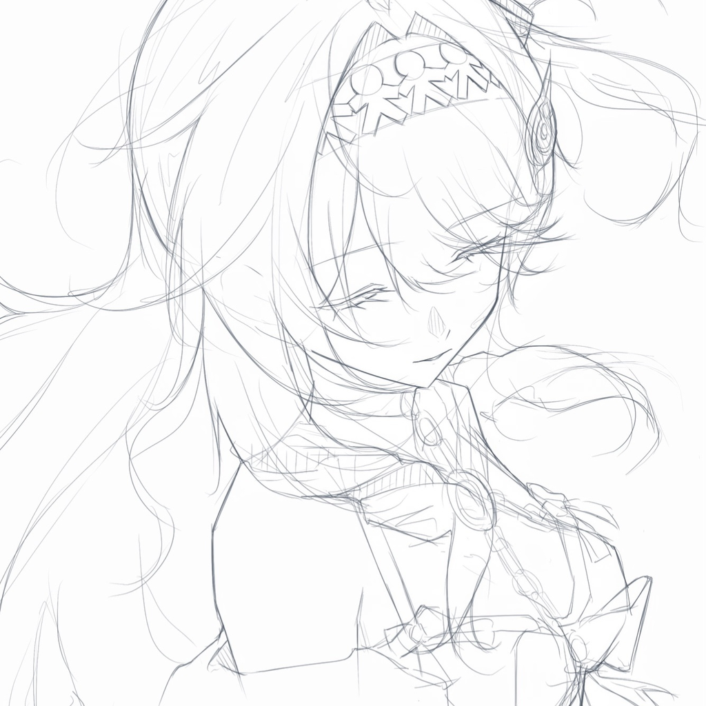

<p align="left">
  
</p>

# HanaCreate

HanaCreate is FOSS (Free and Open-Source Software) digital painting app for Android tablets Windows and Linux.
In currently devlopment focusing on Android tablets. its own Rust drawing engine and GPU renderer, with a Kotlin and Jetpack Compose interface on Android from ProCraft.

This repository forked frrom [artcraft-android/procraft](https://github.com/artcraft-android/procraft). HanaCreate is product name used for this fork. Some Rust crate names, Android and iPad package namespaces, build properties, and inherited files still use ProCraft repository.

**Project status:** active development (If not lazy). The Android app and shared drawing engine contain working painting and editing features. Import compatibility, cross-platform validation, packaging, and product infrastructure are still in progress.

## Project links and availability

- Source code: [xdecember/HanaCreate](https://github.com/xdecember/HanaCreate)
- Upstream project: [artcraft-android/procraft](https://github.com/artcraft-android/procraft)
- License: [MIT](LICENSE-MIT) or [Apache-2.0](LICENSE-APACHE)

The GitHub Actions release workflow starts when you push a `v*` tag. It requires the Android release-signing secrets, builds Android and desktop packages, then creates a draft GitHub Release with checksums. Someone must add release notes and publish that draft before downloads count as a public release. macOS, iPadOS, Windows ARM, and Linux ARM jobs depend on repository settings, secrets, and variables. A workflow run or a local tag is not a published release. Check the [HanaCreate releases page](https://github.com/xdecember/HanaCreate/releases) for downloads.

## What works

### Painting and editing

- Pressure-sensitive brush strokes with size and opacity controls.
- Brush library, brush sets, and Brush Studio.
- Stroke stabilization, streamline, taper, tilt, and brush dynamics for HanaCreate brushes.
- Layers, groups, opacity, visibility, alpha lock, clipping, and masks.
- Blend modes in the drawing engine and GPU renderer.
- Colour pickers, palettes, colour history, and eyedropper.
- Selection, transform, crop, and drawing guides.
- Adjustments and filters, including curves, colour balance, blur, sharpen, bloom, noise, liquify, and clone.
- Text, shapes, gradients, and reference images.
- Undo and redo, gallery stacks, artwork import, and image export.
- Optional plugins, including a Krita brush plugin.

## Demo
(from ProCraft)

<p align="center">
  
</p>

<p align="center">
  
</p>

### Supported file workflows

- Import and export common image formats, including PNG and JPEG.
- Import PSD files.
- Export PDF, TIFF, GIF, and MP4 through the existing export paths.
- Import brush files such as ABR, GIMP brushes, Krita brushes, and Clip Studio Paint SUT files. Imported brushes are converted to HanaCreate's brush model unless a compatible plugin engine handles them.
- Import Clip Studio Paint `.clip` documents. The importer reads document metadata, layer structure, raster content, vector source records, and supported V2 time-lapse snapshots. V1 time-lapse frames are not imported.

### Platforms in the repository

| Platform | Current status |
|---|---|
| Android tablets | Main app target. Android application ID is `com.hanacreate`. Minimum Android version is 8.0 (API 26). |
| Windows | Desktop app and packaging scripts are present. |
| Linux | Desktop app and packaging scripts are present. |
| iPad | SwiftUI app project and an unsigned IPA build script are present. Distribution and device validation remain limited. |
| macOS desktop | Packaging scripts and an optional release workflow are present. It is not a validated public target. |
| Phones | No separate phone app that pocket thingy. The current interface targets tablets. |

## Current compatibility work

Clip Studio Paint import is being tested against two sample documents. These tests describe those samples only. They do not establish complete compatibility with every CLIP document.

| Area | Current | Remaining |
|---|---|---|
| Raster layers | Reads layer hierarchy, raster sources, and previews. | Validate more document variants and edge cases. |
| Vector layers | Preserves original vector records and a raster projection for display and painting. | Editable vector paths and native brush-style replay are not implemented. |
| Brush styles | The `clipfile-rs` dependency exposes BrushStyle and effector-graph data. | Connect the source records to HanaCreate's brush model and verify their behavior against Clip Studio Paint. |
| Stroke dynamics | HanaCreate's own engine supports pressure, velocity, tilt, smoothing, and stabilization. | CLIP input-source flags and imported brush dynamics are not fully mapped or verified. |
| V2 time-lapse | Imports the tested sample's 12 PNG snapshots into HanaCreate time-lapse storage as JPEG frames. | Original recording timing and the original frame encoding are not retained. or found better solution.|
| V1 time-lapse | Retains the original source archive. The tested archive has one V1 time-lapse record with sequence value 15,869 across 11 compressed blobs. | Decode the serialized Offscreen payloads and reconstruct GMIK and GMID frames. This sample is not a WebP stream. |
| Blend modes | The engine and renderer implement blend modes. | Some CLIP modes remain approximations. The two test documents use Normal on every layer, so they do not validate non-Normal import. |
| Masks and animation | Native app code includes masks and animation-related features. | The two test documents do not contain these features, so CLIP import compatibility is unverified. |

The tested V1 archive is 473,780,469 bytes. The importer has streamed and validated its 11 compressed blobs, which contain 565,314,008 decoded bytes. The decoded stream begins with a `20CE` marker and contains `GMIK` and `GMID` records with serialized `Offscreen` payloads and embedded JPEG signatures. This encoder does not use the WebP layout handled by the existing V2 frame indexer. HanaCreate does not yet reconstruct or play these V1 frames.

The importer preserves the source `.clip` archive when it is within the current 512 MiB retention limit. This allows unsupported source data to remain available for later work. Preservation does not mean that HanaCreate can edit or replay that data, Still need more development.

## Work in progress

- Native HanaCreate document architecture and file format.
- Complete 3D painting workflows and validation for OBJ and USDZ models.
- Lossless vector editing and raster/vector hybrid layers.
- CLIP BrushStyle and effector-graph integration.
- Verified CLIP pressure, velocity, and stabilization behavior.
- V1 time-lapse frame reconstruction.
- More CLIP samples for blend modes, masks, animation, and unsupported layer types.
- Cross-device performance and memory testing.
- Platform-specific release and installation workflows.
- Product identity cleanup across inherited ProCraft names and package metadata.

## Not available yet from this repository

- Official app-store distribution or store listings.
- An official HanaCreate Discord server, invite link, or community support channel.
- A published release schedule or support guarantee.
- Complete Clip Studio Paint document, brush, or time-lapse compatibility.
- Editable imported CLIP vector paths.
- V1 CLIP time-lapse playback.
- Verified import of CLIP masks, animation tracks, and non-Normal blend modes.
- A separate phone app.

## Build from source

### Android

Requirements include Rust, JDK 17 or newer, Android SDK, Android NDK, and `cargo-ndk`.

```sh
cd android
./gradlew assembleDebug
```

For a release APK:

```sh
cd android && ./gradlew assembleRelease -Pprocraft.abis=arm64-v8a
```

The release build uses the configured signing key when one is provided. Without a release key, Gradle uses the debug signing key unless you request an unsigned build.

### Desktop

Run the desktop app from the repository root:

```sh
cargo run --release -p procraft-desktop
```

Package Windows with `packaging/windows/package.ps1`. Package Linux with `packaging/linux/package.sh`.

### iPad

The iPad project uses SwiftUI over the shared Rust core. Build an unsigned IPA on a Mac with Xcode and XcodeGen:

```sh
ios/build-ipa.sh
```

An unsigned IPA is not an App Store release. It requires a separate signing and installation process.

### Tests

Run the Rust workspace tests:

```sh
cargo test --workspace
```

Some GPU tests require a compatible graphics device. Device-specific Android and iPad behavior requires testing on those platforms.

## Repository layout

| Path | Contents |
|---|---|
| `crates/engine` | Document model, brush model, stroke processing, file formats, and geometry. |
| `crates/gpu` | GPU canvas, rendering, compositing, and 3D scene support. |
| `crates/core` | Shared application behavior, gallery, editing tools, exports, plugins, and time-lapse storage. |
| `android` | Android application and Gradle build. |
| `desktop` | Windows and Linux desktop application. |
| `ios` | iPad application and build scripts. |
| `plugins` | Optional plugin implementations. |
| `docs` | Architecture notes, implementation status, and project documentation. |

## Documentation

- [Architecture and implementation status](docs/HANACREATE_ARCHITECTURE.md)
- [Plugin development](docs/plugins.md)
- [Startup resource preparation](docs/STARTUP_RESOURCE_ADMISSION_AND_PRELOAD.md)
- [Third-party notices](NOTICE)
- [Asset attribution](ATTRIBUTION.md)

## License

[MIT License](LICENSE-MIT) or [Apache License 2.0](LICENSE-APACHE), at your option. See [NOTICE](NOTICE) and [ATTRIBUTION.md](ATTRIBUTION.md) for third-party components and assets.
